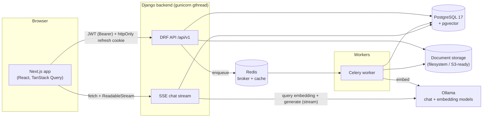
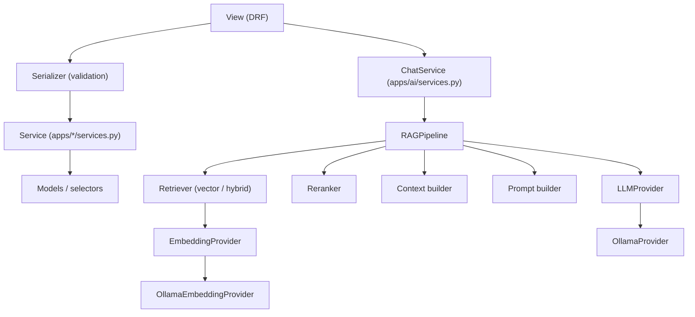
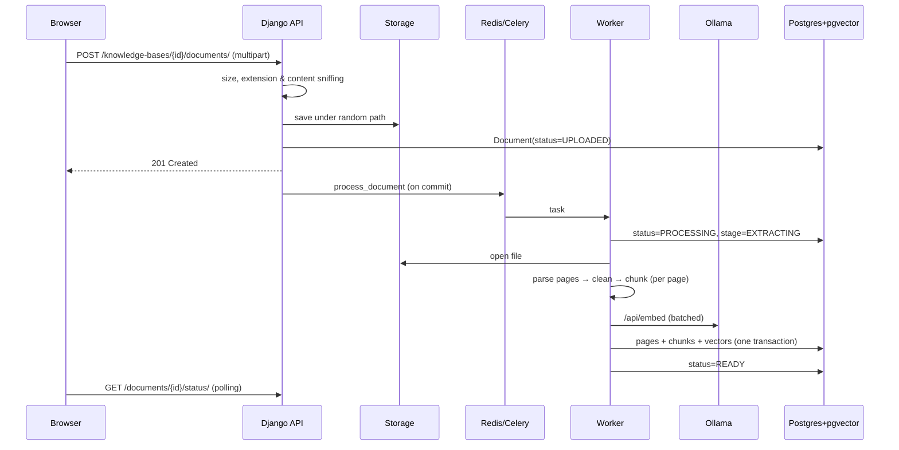

# Architecture

RecallAI is a monorepo with a Next.js frontend and a Django REST backend. All AI runs locally in Ollama; all data lives in PostgreSQL (+ pgvector) and on the local filesystem.

## System overview



## Backend layering

Views stay thin. Business logic lives in services; AI calls go through provider interfaces.



| App | Responsibility |
| --- | --- |
| `accounts` | Custom email-based `User`, JWT auth, refresh cookie, password reset |
| `workspaces` | `Workspace`, `WorkspaceMember`, roles (OWNER / ADMIN / MEMBER / VIEWER) |
| `knowledge` | `KnowledgeBase` and the scoping selectors used everywhere |
| `documents` | Upload validation, storage, parsers, cleaning, chunking, Celery pipeline |
| `ai` | Providers (`LLMProvider`, `EmbeddingProvider`), RAG pipeline, chat service, search |
| `conversations` | `Conversation`, `Message`, `Citation`, SSE streaming endpoint |
| `study` | Study set generation (structured JSON output), attempts and scoring |
| `usage` | `UsageRecord`, usage API, admin analytics |
| `health` | Liveness and readiness probes (DB/pgvector, broker, Ollama models) |
| `common` | Permissions, error envelope, logging, pagination, storage, throttles |

## Workspace isolation

Every request follows the same authorization chain, enforced on the server:

```text
request.user → workspace membership → resource belongs to workspace → role check
```

* Querysets are always built from `member_workspace_ids(user)` (`common/permissions.py`), so objects from other workspaces are invisible.
* Outsiders receive **404**, not 403, so the existence of other workspaces' resources is never revealed.
* Members with an insufficient role receive **403**. Capabilities: `VIEW` (viewer+), `CONTRIBUTE` (member+), `MANAGE` (admin+), `OWN` (owner).
* Vector search filters by `knowledge_base_id` taken from an already-authorized knowledge base — retrieval can never return another workspace's chunks.
* Conversations and study sets are private to their creator *and* require continued workspace membership.

Automated tests cover cross-workspace access for workspaces, knowledge bases, documents, files, pages, search, retrieval, conversations, streaming, study sets and usage.

## Document processing



Failures set `status=FAILED` with the real error in `processing_error`. Transient Ollama outages are retried with exponential back-off before failing. `POST /documents/{id}/reprocess/` rebuilds pages and chunks from scratch.

## Authentication

* `POST /auth/login/` returns a short-lived **access token** (15 min) in the body and sets a **refresh token** as an `httpOnly`, `SameSite=Lax` cookie scoped to `/api/v1/auth/` (Secure in production).
* The frontend keeps the access token **in memory only**. On load it calls `/auth/refresh/` to restore the session; on any 401 it refreshes once (single-flight) and retries.
* Refresh tokens rotate and the old token is blacklisted; logout blacklists the current one.

## Storage

Uploaded files go through `common/storage.py`, which wraps the Django storage alias `documents`. Paths are generated server-side (`workspace_<id>/kb_<id>/<uuid>.<ext>`); user filenames are only kept (sanitized) for display. Switching to S3 / Supabase Storage is configuration only:

```env
DOCUMENT_STORAGE_BACKEND=storages.backends.s3.S3Storage
DOCUMENT_STORAGE_OPTIONS={"bucket_name": "recallai-docs"}
```

## Observability

* Structured JSON logs with `request_id`, `user_id`, `workspace_id`, `operation`, `duration_ms`, `success`, `error`.
* AI operations additionally log `model`, `input_tokens`, `output_tokens` and `latency_ms`.
* Every response carries `X-Request-ID`; error bodies include the same id.
* Passwords, tokens and document contents are never logged.
