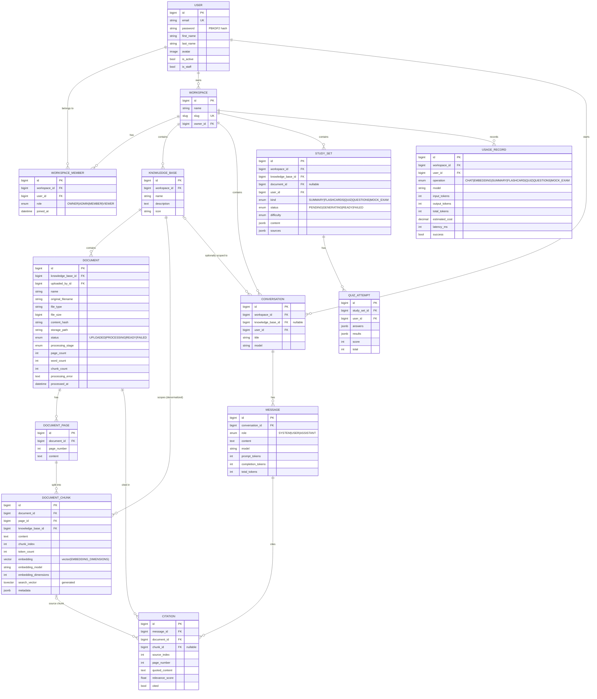

# Database

PostgreSQL 17 with the `vector` extension (pgvector). The extension is created by the first `documents` migration.

## Indexes

| Table | Index | Purpose |
| --- | --- | --- |
| `documents_documentchunk` | HNSW on `embedding` (`vector_cosine_ops`) | Fast approximate nearest-neighbour search |
| `documents_documentchunk` | GIN on `search_vector` | Full-text search for hybrid retrieval |
| `documents_documentchunk` | `(knowledge_base_id, embedding_model)` | Scope retrieval before / alongside the vector scan |
| `documents_documentchunk` | unique `(document_id, chunk_index)` | Idempotent rebuilds |
| `documents_documentpage` | unique `(document_id, page_number)` | Page lookup for the viewer |
| `documents_document` | `(knowledge_base_id, -created_at)`, `(knowledge_base_id, status)` | Listings and readiness checks |
| `workspaces_workspacemember` | unique `(workspace_id, user_id)`, `(user_id, workspace_id)` | Membership checks on every request |
| `conversations_conversation` | `(user_id, workspace_id, -updated_at)` | Chat history |
| `usage_usagerecord` | `(workspace_id, -created_at)`, `(user_id, -created_at)` | Usage dashboards |

## Embedding dimensions

The `embedding` column is created with `EMBEDDING_DIMENSIONS` (768 for nomic-embed-text). To use a model with a different size on an existing database, create a migration that alters the column (and recreates the HNSW index) and reprocess documents. Fresh installs pick the value up automatically.
